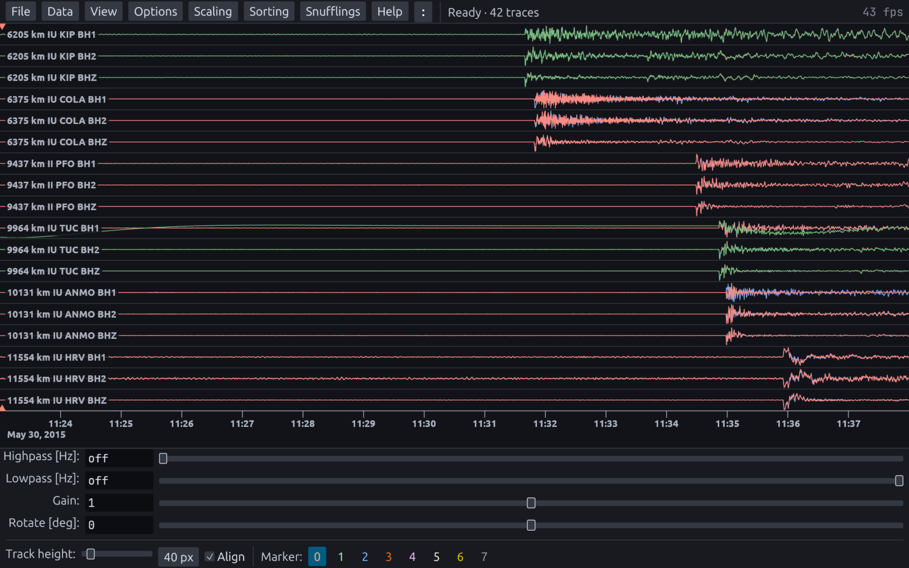

# snuffler-web

A browser version of [Snuffler](https://pyrocko.org), pyrocko's seismic waveform inspector.
pyrocko, numpy and scipy run unchanged, compiled to WebAssembly with
[Pyodide](https://pyodide.org); only the user interface is new.
Everything runs in the browser, and files you open are not uploaded.

<p align="center">
  <br>
  <picture>
    <source media="(prefers-color-scheme: light)" srcset="https://raw.githubusercontent.com/romnn/snuffler-web/main/docs/screenshots/hero-light.png">
    
  </picture>
  <br>
  Surface waves from the 2004 Sumatra earthquake: three components per station, sorted by distance.
  <br><br>
</p>

Try the live version in your browser without installing anything:

- [romnn.github.io/snuffler-web/](https://romnn.github.io/snuffler-web/) — stable, the latest release.
- [romnn.github.io/snuffler-web/latest/](https://romnn.github.io/snuffler-web/latest/) — the latest `main` build.

## What it does

- Opens MiniSEED, SAC and the other formats pyrocko reads, from your disk, from FDSN data
  centers, or as a live SeedLink stream.
- Shows them as snuffler does, with its filters, rotation, scaling, sorting, markers and picks,
  and its `:` command line.
- Runs snuffler's built-in snufflings: spectra, spectrogram, polarization, STA/LTA, cake phase
  arrivals, seismosizer and SeisBench pickers.
- Searches earthquake catalogs and shows stations and events on a map.
- Exports figures as PNG or SVG.
- `File ▸ Examples` loads recorded earthquakes; each example has its own link.

## What it does not do

- Load your own snufflings: only snuffler's built-in ones are ported.
- Read instrument responses from RESP files; StationXML works.
- Open files by path or from the command line: you pick them in the browser.

The first visit downloads the Python runtime, which takes some time; later visits use the
browser cache.

## Host it yourself

To run only the app, without snuffler-web-proxy:

```sh
# http://127.0.0.1:8000
docker run --rm -p 8000:8080 ghcr.io/romnn/snuffler-web/web:latest
```

Without snuffler-web-proxy there is no live data: live SeedLink streams use TCP, which a browser
cannot open, so the proxy carries them over a WebSocket.
The proxy also retries downloads from the few data centers that browsers cannot read directly.
To run both, use [`docker-compose.yaml`](docker-compose.yaml), or the Helm charts described in
[docs/kubernetes.md](docs/kubernetes.md).

## Development

[mise](https://mise.jdx.dev) installs the pinned toolchain, including
[micromux](https://github.com/romnn/micromux), which runs the app and the proxy:

```sh
mise install          # the toolchain
task pyodide:fetch    # the Pyodide runtime with pyrocko, as deployed
micromux              # http://snuffler-web.localhost
```

`task pyodide:build` builds the runtime instead, which takes about an hour.
Each checkout gets its own address, `http://<checkout>.localhost`, on port 80, or on 17680 when
80 is taken.
`task --list` shows every other task, and [docs/ARCHITECTURE.md](docs/ARCHITECTURE.md) explains
how the parts fit together.
